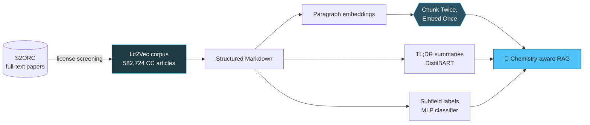

<!-- ===================== HEADER ===================== -->
<p align="center">
  
</p>

<p align="center">
  <a href="https://github.com/mahmoud-amiri">
    
  </a>
</p>

<p align="center">
  <a href="https://orcid.org/0009-0001-3826-1789"></a>
  <a href="https://scholar.google.com/citations?user=vWPEHQIAAAAJ&hl=en"></a>
  <a href="https://www.researchgate.net/profile/Mahmoud-Amiri"></a>
  <a href="https://linkedin.com/in/m-ami"></a>
  <a href="mailto:mahmoud.amiri@uni-jena.de"></a>
</p>

<p align="center">
  
  
  
</p>

---

## 🧬 About me

```python
class MahmoudAmiri:
    affiliation = ["Leibniz IPHT", "Friedrich Schiller University Jena", "Bocklitz Lab"]
    mission     = "Get chemistry literature into a form machines can search and reason over."
    interests   = ["Retrieval-Augmented Generation", "Scientific Text Mining",
                   "Embeddings & Chunking", "Reproducible Research Workflows"]
    values      = ["open data", "license-aware corpora", "reproducibility"]

    def current_focus(self):
        return "Chemistry-aware RAG on top of the Lit2Vec corpus"
```

---

## 🔬 Research pipeline

> How my projects fit together — GitHub renders this diagram live.



---

## 📄 Selected publications

<details open>
<summary><b>📚 Lit2Vec</b> — a reproducible workflow for building a license-screened full-text chemistry corpus</summary>
<br/>

A reproducible pipeline that turns S2ORC into an open corpus of **582,724 CC-licensed chemistry articles**, normalized to structured Markdown with paragraph embeddings, TL;DR summaries and topic labels.

<a href="https://arxiv.org/abs/2604.12498"></a>
<a href="https://github.com/Bocklitz-Lab/Lit2Vec-code"></a>

</details>

<details>
<summary><b>✂️ Chunk Twice, Embed Once</b> — chunking and embedding choices for chemistry-aware RAG</summary>
<br/>

A systematic study of how chunking strategy and embedding model choice affect retrieval quality on chemistry text.

<a href="https://arxiv.org/abs/2506.17277"></a>
<a href="https://github.com/Bocklitz-Lab/chunk_twice_embed_once"></a>

</details>

<details>
<summary><b>🧠 Metabolic Minds and Machine Models</b> — a comparative review of efficiency mechanisms</summary>
<br/>

<a href="https://github.com/Bocklitz-Lab/Metabolic-Minds-and-Machine-Models"></a>

</details>

<p align="right"><a href="https://scholar.google.com/citations?user=vWPEHQIAAAAJ&hl=en">→ Full list on Google Scholar</a></p>

---

## 🚀 Featured projects

<p align="center">
  <a href="https://github.com/Bocklitz-Lab/Lit2Vec-code">
    
  </a>
  <a href="https://github.com/Bocklitz-Lab/chunk_twice_embed_once">
    
  </a>
  <br/>
  <a href="https://github.com/Bocklitz-Lab/lit2vec-subfield-classifier">
    
  </a>
  <a href="https://github.com/Bocklitz-Lab/lit2vec-tldr-bart">
    
  </a>
</p>

---

## 🛠️ Toolbox

<p align="center">
  
</p>

<p align="center">
  
  
  
  
  
</p>

---

## 📊 GitHub stats

<details open>
<summary><b>Click to expand / collapse</b></summary>
<br/>

<p align="center">
  
  
</p>

<p align="center">
  
</p>

<p align="center">
  
</p>

</details>

---

## 🐍 Contribution snake

<p align="center">
  <picture>
    <source media="(prefers-color-scheme: dark)"  srcset="https://raw.githubusercontent.com/mahmoud-amiri/mahmoud-amiri/output/github-contribution-grid-snake-dark.svg"/>
    <source media="(prefers-color-scheme: light)" srcset="https://raw.githubusercontent.com/mahmoud-amiri/mahmoud-amiri/output/github-contribution-grid-snake.svg"/>
    
  </picture>
</p>

---

## 🤝 Let's collaborate

<details>
<summary><b>I'm open to collaborations on…</b></summary>
<br/>

- 🧪 Scientific literature mining & information extraction
- 🔎 Retrieval evaluation and RAG for domain-specific science
- 📦 Building open, license-clean research corpora
- ♻️ Reproducible ML workflows

📬 Reach me at **mahmoud.amiri@uni-jena.de**

</details>

<!-- ===================== FOOTER ===================== -->
<p align="center">
  
</p>

